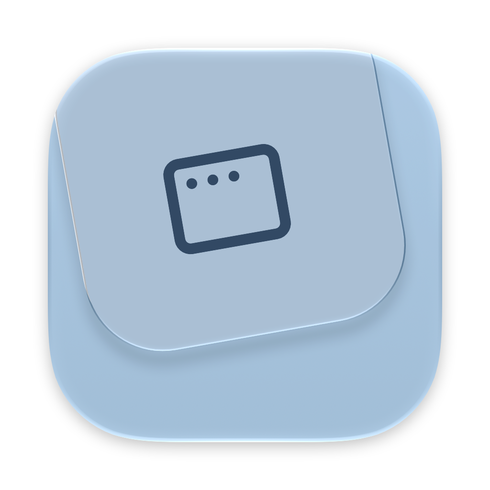

<div align="center">
  
  <h1>Icon Shadow</h1>
  <p>A native macOS utility for adding shadows and padding to replacement app icons.</p>
  <p>English · <a href="README.zh-Hans.md">简体中文</a></p>
</div>

Drop in a PNG or ICNS, adjust its size and shadow, and export an ICNS ready to use in Finder. Icon Shadow runs locally and does not upload your artwork.

## Features

- PNG and ICNS import, with drag and drop or a file picker.
- Automatic transparent-edge trimming and proportional artwork scaling, measuring the body separately from faint exterior shadows.
- Continuous-corner mask and alpha-based Gaussian shadow.
- Live controls for scale, horizontal/vertical position, shadow opacity, blur and offset.
- Original/processed comparison, with light and dark preview backgrounds.
- 1024 × 1024 PNG and multi-resolution ICNS export.
- macOS 26 and macOS 27 presets.
- English and Simplified Chinese, following the system's application language.

## Requirements

macOS 14 or later. Supports Apple silicon and Intel Macs.

## Installation

Open the release DMG and drag **Icon Shadow** into **Applications**. Launch it from Applications.

## Usage

1. Drop a PNG or ICNS into the window, or choose **File → Open…** (`⌘O`).
2. Use the default preset or adjust the artwork and shadow in the inspector.
3. Click **Export ICNS** (`⌘E`). PNG export is available in the adjacent menu.

To apply the result, select the exported ICNS in Finder and copy it. Open the target application's **Get Info** window, select the small icon in its upper-left corner, and paste.

Protected system applications may reject custom icons. Icon Shadow exports icon files; it does not modify installed application bundles.

## Presets and existing shadows

The macOS 26 and 27 presets currently share the same exterior-shadow settings, calibrated against exported system icons: 824 px artwork on a 1024 px canvas, black at 25% opacity, a 15 px Gaussian blur and an 8 px downward offset. These settings reproduce a static silhouette and shadow; glass materials and internal lighting remain part of your source artwork. See [rendering research](docs/RenderingResearch.md) for measurements and sources.

If your source already has a shadow, set **Shadow Opacity** to zero to avoid adding another one. To preserve an already finished icon's canvas, also disable **Trim Transparent Edges** and **Fit to Mask**, set scale to 100%, and keep both positions at zero. An existing shadow cannot be separated reliably from flattened artwork. Enlarging a low-resolution source does not recover missing detail.

## Build from source

Requires Xcode 27.1 or later, including Icon Composer support for the layered application icon. No third-party runtime dependencies are required.

Open `IconShadow.xcodeproj`, select **IconShadow → My Mac**, and run with `⌘R`. For a local Release build:

```sh
./scripts/build.sh
open 'build/Icon Shadow.app'
```

Run the rendering and export tests with:

```sh
swift test
```

The Swift package contains the rendering engine and its tests. Use the Xcode project to edit and build the application. The app uses Swift 6, SwiftUI, AppKit, Core Graphics, Core Animation and Core Image, and invokes the system `iconutil` for ICNS export.

Developer ID signing, notarization and DMG packaging are documented in [Releasing](docs/Releasing.md). The editable application icon is [Artwork/IconShadow.icon](Artwork/IconShadow.icon).

## Contributing

Issues and pull requests are welcome. For rendering problems, include the input format and dimensions, macOS version, settings, and screenshots of the expected and actual result. Use artwork you have permission to share. Run `swift test` and build the application before submitting code changes.

## Acknowledgments

- [macOSicons Icon Toolkit](https://macosicons.com/editor/toolkit) for the workflow reference.
- [macicon](https://github.com/DarkRader/macicon) for the packaging reference.
- [iccir's macOS icon templates](https://gist.github.com/iccir/053ebec1ad3a53fad3dbfbf76743ea94) for the original rendering measurements.
- [Lucide](https://lucide.dev/) for the application-window symbol used in the logo, under the [ISC license](Artwork/ThirdParty/Lucide-LICENSE.txt).

## License

[MIT](LICENSE). Third-party artwork retains its own license as noted above.
