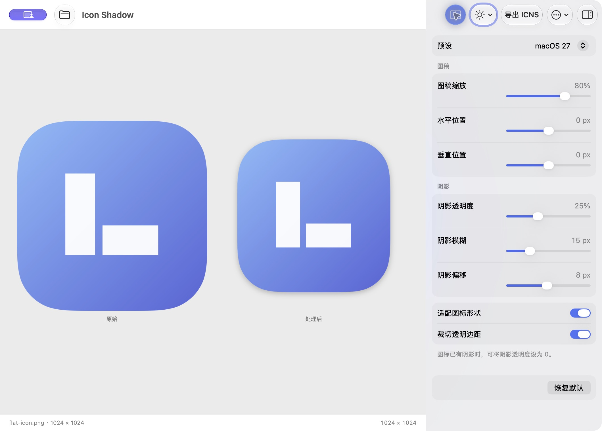

<div align="center">
  
  <h1>Icon Shadow</h1>
  <p>为替换用的 macOS 应用图标添加阴影并调整透明边距。</p>
  <p><a href="README.md">English</a> · 简体中文</p>
</div>

拖入 PNG 或 ICNS，调整主体尺寸和阴影，再导出可用于 Finder 替换图标的 ICNS。所有图像处理都在本机完成，不会上传素材。

<p align="center">
  
</p>

## 功能

- 通过拖放或文件选择器导入 PNG、ICNS。
- 自动裁切透明边距，按主体识别尺寸，避免把外围淡阴影计入缩放；保持图稿原始比例。
- 连续圆角遮罩，以及按透明轮廓生成的高斯阴影。
- 实时调整缩放、水平和垂直位置、阴影透明度、模糊和偏移。
- 原图与处理结果对比，支持浅色、深色预览背景。
- 导出 1024 × 1024 PNG，以及包含多分辨率资源的 ICNS。
- macOS 26、macOS 27 预设。
- 简体中文和英文，跟随系统的应用语言设置。

## 系统要求

macOS 14 或更新版本，支持 Apple silicon 和 Intel Mac。

## 安装

打开正式版 DMG，将 **Icon Shadow** 拖入 **Applications（应用程序）**，然后从应用程序文件夹启动。

## 使用

1. 将 PNG 或 ICNS 拖入窗口，也可以使用 **文件 → 打开…**（`⌘O`）。
2. 使用默认预设，或在右侧面板调整图稿和阴影。
3. 点击 **导出 ICNS**（`⌘E`）。旁边的菜单提供 PNG 导出。

在 Finder 中选中导出的 ICNS 并复制。打开目标应用的**显示简介**窗口，选中左上角的小图标，再粘贴。

受系统保护的应用可能不允许替换图标。Icon Shadow 负责生成图标文件，不会修改已安装应用的内容。

## 预设与已有阴影

macOS 26、27 预设目前使用相同的外部阴影参数，根据系统图标样本校准：1024 px 画布、824 px 图稿主体、25% 黑色阴影、15 px 高斯模糊，以及向下 8 px 偏移。它们处理静态轮廓与阴影，玻璃材质和内部光照保留自原图。测量过程和来源见[渲染研究](docs/RenderingResearch.md)。

原图已有阴影时，可将**阴影透明度**设为 0，避免再次叠加。若要保留已处理图标的完整画布，同时关闭**裁切透明边距**和**适配图标形状**，将缩放设为 100%，位置归零。已经合成进图像的阴影无法可靠地自动分离；放大低分辨率素材也不会恢复细节。

## 从源码构建

需要 Xcode 27.1 或更新版本，以编译分层应用图标。运行时没有第三方依赖。

打开 `IconShadow.xcodeproj`，选择 **IconShadow → My Mac**，按 `⌘R` 运行。也可以构建本地 Release 版本：

```sh
./scripts/build.sh
open 'build/Icon Shadow.app'
```

运行渲染与导出测试：

```sh
swift test
```

Swift Package 用于独立测试渲染引擎；编辑和构建应用请使用 Xcode 工程。应用采用 Swift 6、SwiftUI、AppKit、Core Graphics、Core Animation 和 Core Image，通过系统 `iconutil` 导出 ICNS。

Developer ID 签名、公证和 DMG 打包流程见[发布说明](docs/Releasing.md)。应用图标源文件为 [Artwork/IconShadow.icon](Artwork/IconShadow.icon)，可用 Icon Composer 编辑。

## 参与贡献

欢迎提交 Issue 和 Pull Request。报告渲染问题时，请附上素材格式和尺寸、macOS 版本、参数，以及预期和实际效果的截图；仅分享你有权公开的素材。提交代码修改前，请运行 `swift test` 并完成应用构建。

## 致谢

- [macOSicons Icon Toolkit](https://macosicons.com/editor/toolkit)：工作流程参考。
- [macicon](https://github.com/DarkRader/macicon)：图标打包参考。
- [iccir 的 macOS 图标模板](https://gist.github.com/iccir/053ebec1ad3a53fad3dbfbf76743ea94)：原始渲染测量参考。
- [Lucide](https://lucide.dev/)：Logo 中的应用窗口符号，遵循 [ISC 许可证](Artwork/ThirdParty/Lucide-LICENSE.txt)。

## 许可证

[MIT](LICENSE)。第三方素材保留各自的许可证。
